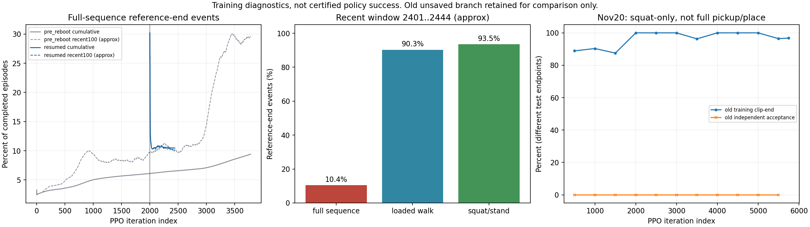

# Full-sequence plateau：11.20历史训练、当前Unified HOI与原始HMI对比

分析日期2026-11-22。当前训练源版本`bf30383`，仓库分析前HEAD `d83d149`；未修改过的上游固定为`c353731999b3578c41ad5a00f896415b45e6a9f5`。本次为只读诊断：当前8192环境训练继续运行，没有新增Isaac进程，没有改变奖励、控制、终止、数据或最终验收。

## 结论

1. 当前完整取放箱确有瓶颈，不能只用“再等到15000次”解释。恢复分支最近窗口的参考末帧终止事件约10%，主要困难在放箱／支撑转移／释放，以及取箱时的低姿态平衡。
2. 目前不支持“基础Tracking全部被改坏、任何动作都无法完成”。近期加载行走／蹲起的参考末帧终止事件约90%／94%；它们还不是最终物理成功率。理想参考增量动作均远低于100的动作裁剪上限；未发现参考脚间距必然触发5cm终止的矛盾。
3. PPO、训练入口和原Tracking函数源码与上游一致，但当前的生效任务已不是上游原配置：Actor目标、动作参数化、增益／尺度、物理步长、探索、采样和物理终止有实质差异。不能把“沿用PPO和八项Tracking奖励”说成“训练条件完全等价”。
4. 新增HOI逻辑有两处明确风险：离地前抓握塑形被`carrying_gate`清零；已合法释放后，一次支持样本不合格即可重新触发失握终止。后者已用CPU逻辑反例复现，但尚无训练Policy逐帧PhysX证据证明其实际贡献。
5. 11.20的0/20不能直接用于证明同一个完整取放箱motion无法学习：当时只训练蹲起，且后续审计发现评估Reset入口问题。另一条旧MVP训练也只含0.5kg小箱的carry/hold裁剪片段，不含取放箱。

## 1. 当前曲线是否真的没有进展

读取原始事件文件，分别处理重启前分支与恢复分支，没有把旧的未保存2001–3782混入续训曲线。当前快照截至迭代2444；不是对之后所有迭代的判断。

TensorBoard `Env/stage1/family/*/completed/termination/clip_timeout` 是本进程累计的已结束episode中参考末帧事件比例。它会被早期失败历史拖住，并在恢复进程中重新累计。自然结束也可能与其他终止标记重叠；不是最终任务成功率。

| 分支／窗口 | full sequence | loaded locomotion | loaded squat/stand |
|---|---:|---:|---:|
| 当前累计，step2444 |10.46%|89.83%|94.33%|
| 当前近期窗口2401–2444，近似 |10.40%|90.27%|93.49%|
| 重启前近期窗口3501–3782，未保存分支，近似 |29.10%|96.97%|90.64%|

Full-sequence恢复后的近期窗口2051–2100、2101–2200、2201–2300、2301–2400，分别约10.69%、10.89%、10.27%、10.20%。因此这几百次内确有停滞迹象，并非单纯画图问题。

但重启前原分支3001–3500约25.81%，3501–3782约29.10%。它并非从未改善；这些权重未保存，实际恢复的是2000 checkpoint。这个事实不能变成“恢复已保留3782次进度”，也不能保证重训完全复现相同改进。

窗口计算：`(累计比例_end×累计回合数_end−累计比例_start×累计回合数_start)/(回合数_end−回合数_start)`。TensorBoard把24步内的累计计数和比例分别取均值，因此这是忽略窗口端点微小协方差的近似。终止原因可重叠，不能要求百分比相加100%。

## 2. 当前具体卡在哪里

step2444的phase逐控制步统计（每步20ms），与上面的episode比例分母不同：

| 指标 | pickup | putdown |
|---|---:|---:|
| `physical_failure`标记／控制步 |0.2045%|2.2782%|
| `fall`标记／控制步 |0.1421%|1.1553%|
| `loss_of_grasp`标记／控制步 |0|0.6057%|
| `body_support`标记／控制步 |0.0569%|0.5645%|
| `track_failure/object_pos`／控制步 |0.0689%|0.3783%|
| Robot平均body位置误差 |6.26cm|9.95cm|
| Object平均位置误差 |6.70cm|10.85cm|

放箱阶段的每步物理终止率约为取箱的11倍。`fall`是组合条件标签，不足以断言每次都发生了真实跌倒；`body_support`实际检测非手部接触力，不等同已证实用身体承担重量。

实际步骤覆盖：pickup8.94%、carry84.67%、putdown6.38%。family配额仍严格约30/35/35，但并不保证每个任务phase获得相同比例的有效时间。三类动作共同训练时，加载carry占绝大多数有效步骤。

这说明问题集中在完整HOI阶段，不能仅看总奖励或整体双手接触率就认定full-sequence已学会。还不能从聚合日志恢复“哪一帧、哪次支持力波动、哪个fall子条件先触发”的因果顺序。

## 3. 11.20长训到底训练了什么

本地找到两组相关历史；都不冒充为当前完整取放箱的同条件baseline。

### A. `fullbody_goal_carry/run_20261120_133333`

- 8192环境，Stage1 Track-only，1.1kg原始LargeBox。
- 正式Motion目录只有P0单周期与双周期蹲起；forward在`quarantine/`，没有pickup/putdown。
- 训练管理状态记录5500个已完成分段更新，最后worker到迭代5743；停止原因是`Job timeout/budget reached: stage1_training`，没有完成15000次。
- 500到5500的11轮独立验收全部0/20，首episode平均仅0.1秒。
- 同时训练内部后期episode自然结束比例约96.8%，与0/20形成明显矛盾。不能把两种统计当作同一个“完成率”。

后续`STAGE1_PRETRAIN_AUDIT.md`有直接证据：同一旧Policy在兼容控制接口和修正首帧Reset入口下，单周期首帧16/16走到7.02秒，双周期16/16走到13.02秒。说明旧模型确有片段存活／跟踪能力，旧0/20不能单独证明它什么都没学会。

但Object误差约8–9cm，部分接触率不足99%，仍未通过4cm等最终标准。修正评估入口不等于Policy验收通过。

当时还存在95%软限位静默裁剪合法参考、一帧参考滞后、fixed-default动作中心等问题。它们已在当前Stage1修复，不能把它们继续当成当前失败的已证实原因。旧训练0.1秒失败、Actor接管前20ms零动作、软限位裁剪与未通过物理标准应分别讨论。

### B. `auto_training/run_20261119_200626_511358`（11.19–11.20旧MVP）

- 0.5kg、0.28×0.40×0.30m缩小箱体，掌心承托。
- Manifest明确写着`carry only; no pickup or place`，源动作只取`[95,205)`，保留root/legs，MVP上肢固定姿态+FK，另有静态hold参考。
- 旧Stage1三条clip曾按旧标准全部通过；后来的Stage2因goal/tracking等问题停滞。

它不能证明“原始1.1kg箱体的完整取放箱曾经训练失败／成功”，也不是未修改过HMI的对照。

## 4. 与未修改过的上游Object Stage1的精确差异

以下源码SHA256逐一相同：`train_agent.py`、`agents/ppo/ppo.py`、`agents/modules/logging_utils.py`、原WBT reward与termination文件、原G1 experiment与observation presets。证据见compact JSON和`core_source_identity.json`。

原始G1半球手URDF与LargeBox资产也未被改写。新增Carry类通过继承／配置替换改变行为；公共MotionCommand只加了默认行为不变的Reset Hook，公共关节动作项加默认中心Hook，Simulator使solver迭代数可配置。

| 项目 | 上游Object Stage1（README Track-only命令） | 当前Unified HOI |
|---|---|---|
| PPO与共享Actor/Critic算法 |原HMI PPO|同一PPO，子类增加保存／导出|
| 8项Robot/Object imitation |原函数、权重和sigma|相同；Track=1时mask等价|
| Actor目标 |物体终点位置／姿态Goal|4D速度／骨盆高Goal＋3类intention|
| Actor历史 |默认1帧；1秒history augmentation配置默认未开启|119D×3帧=357D，无Reference输入|
| Critic |原privileged tracking观测|物理／mode119D＋reference68D=187D|
| 动作目标 |`q_default + s*a`|`q_measured_at_step + s*a`，20ms内保持|
| 物理／PD步长 |5ms，decimation4|1ms，decimation20；policy均20ms|
| PD增益 |原值|大部分Kp×4、Kd×2；踝额外提高到250／12|
| action scales |effort/Kp计算|同公式但Kp更大，多数scale为原1/4|
| 探索std |1.0|保留0.3；多数关节初始目标位置噪声约为原1/13.3|
| PPO minibatches／epochs |4／5|128／5，每update640次优化而非20次|
| 初始学习率 |Actor/Critic1e-4，自适应|相同；不是固定不变的1e-4|
| Episode age随机化 |开启|关闭，保持reference时钟一致|
| Reference Reset噪声 |关节／root／object有噪声、95%软限位裁剪|零噪声，真实硬限位校验后精确Reset|
| Reference时钟 |原callback更新时序|post-action对齐k+1，消除共同一帧滞后|
| Reference数据 |原完整搬箱与mirror|两条完整、两条加载crop、两条P0蹲起|
| Motion/frame采样 |原自适应采样|固定family配额；full序列phase均匀抽帧＋25%frame0；loaded保留自适应|
| 训练期终止 |参考误差、脚接近、timeout等|加真实夹持／非手接触／跌倒／离地等phase物理判定|
| Tracking终止的位置项 |root／body三维误差|root／body Z-only；Object仍三维|
| 物理随机化 |质量、材料、惯量等开启|固定实测1.1kg、P0材料／惯量|
| Horizon／存储 |10秒，3000 checkpoint＋100 latest alias|30秒，2000 checkpoint，训练总计15000|

重要补充：上游`goal_object_reached_once`只对Gen给奖励，在Track-only中为零。因此其移除不能被拿来解释Stage1瓶颈。

128 minibatches保留自现有实验，未在本次偷偷改回4。它增加每次update的优化次数与自适应LR调整机会；和上游同样15000个iteration并不意味着完全相同优化过程。哪些差异对完整动作贡献最大，需要受控消融，不能仅靠表格判定。

## 5. 已确认的新增逻辑风险

### 5.1 取箱离地前，抓握塑形实际上为零

`grasp()`乘`carrying_gate()`；后者要求箱底>3cm。`pickup_reward()`又要求已达到双手接触、摩擦支撑≥0.8且箱底>3cm的acquired条件。因此，箱子仍由地面支持时，侧向接触与预紧力本身得不到这两项物理抓握奖励。

这不是把Tracking奖励关闭：八项模仿仍工作。但对于“先接触／预紧、再摩擦提起”的新增任务，物理塑形延迟到已经离地之后，是明确的阶段设计缺口。它会加大学习难度；不能由此直接证明该任务不可能学会。

### 5.2 合法放箱释放后，瞬时支持判定可能重新激活失握终止

当前`loaded = (mode==putdown) & ~stable_support_sample`。`stable_support_sample`取当前ground传感器样本、速度和clearance；它没有使用已经累计确认的support/release状态作滞回。双手合法释放后，基类unsupported计时仍持续累积。

CPU逻辑反例：先连续支持／释放0.8秒，代码报告putdown success；随后仅将一个support_sample置false，保持根姿态、箱底与无非手接触等其余条件不变，立即出现loss_of_grasp。这个测试没有运行物理，不证明真实传感器一定抖动，也不证明它解释了当前所有放箱失败。

真实因果证据仍需训练Policy失败前后地面力、速度、support dwell、双手力与fall子条件的逐帧记录。当前TensorBoard聚合值无法完成这项归因。不能靠扩大最终验收门槛或取消碰撞／重力解决。

### 5.3 full_sequence没有原样使用HMI的困难时间bin自适应

`_sample_adaptive_reset_states()`先调用原sampler，但对full_sequence又用phase均匀帧池覆盖了采样的时间`t`。因此full序列的failure EMA并不直接提高困难时间bin的Reset概率。Loaded clips仍使用原bin采样。这个设计曾为阶段覆盖引入，但与“完全原样自适应Track训练”有明确差异。

当前full序列30%的family步骤内，取放箱有效暴露仍较少；随机后半段Reset也会让clip_timeout无法代表完整任务。应把family份额、phase份额和完整frame0 rollout分别报告。

## 6. 已排除与尚未排除

- 原始NPZ和P0蹲起未覆盖；规范化FK误差已在前次验证至约1.38e-7m，当前没有发现新的格式／四元数接口异常。
- 理想增量动作`(q_ref[k+1]-q_ref[k])/scale`：完整／行走最大约2.469，蹲起约0.138，没有元素超过clip100。这仅排除简单动作范围不可达，不证明受限力矩下动态可行。
- 原完整／mirror参考最小脚接近距离6.935cm，大于5cm终止阈值，没有“完美参考必触发脚接近”的静态矛盾。
- Carry段参考手框架相对箱体最大位移约1.985cm，小于2.5cm最终代理阈值；没有发现确定的该项参考自冲突，但误差余量只有约5mm。它不是实际材料接触滑移。
- 完整参考骨盆最低约0.490m，新增fall高度阈值0.45m只留约4cm余量；root-up最低0.337，需依赖深前倾时的双足支持判定。不能仅凭`fall`标签区分高度越界、倾倒或脚力不足。需终态证据；目前不能直接定性为真实跌倒或误判。
- P0蹲起物理验证是不同验证控制器的结果；不能证明PPO已通过，也不能用初始PD／随机Policy失败证明所有训练都不可能。
- 原object position sigma0.3m：8cm误差仍给出约0.931的该项归一化奖励。因此奖励很高、参考片段到末帧，与4cm独立验收达标不是一回事。

## 7. 最小的后续验证与当前执行决定

本次分析已完成历史／当前原始日志对照、上游源码hash与配置审计、动作与脚接近的CPU检查、放箱门控CPU逻辑反例。没有新增Policy物理验收，也没有在训练GPU上并发Isaac。

当前训练保持原配置继续总计15000更新。后续串行物理诊断应优先捕捉固定checkpoint在full frame0、取箱接触段、放箱／释放段的首失败前后状态，并将原HMI tracking判定和新增HOI判定逐帧并列；确认误判与真实失败之后，再做有边界的phase reward／termination修正和对照。最终物理验收保持原标准。

现阶段能下的结论是：完整HOI学习确有阶段瓶颈，新增阶段奖励／终止值得优先修正验证；没有证据支持“PPO或八项基本Tracking数学被破坏”，也不能在没有对照rollout的情况下把全部责任归给参考不可行、迭代不足或某一个超参数。

## 证据与复现

- [摘要JSON](experiments/unified_hoi/plateau_analysis_20261122.json)
- [曲线图](experiments/unified_hoi/full_sequence_plateau_20261122.png)
- 原始分析输出：`../artifacts/unified_hoi_hmi_stage1/diagnosis_full_sequence_20261122/`，含current_training_analysis、historical_fullbody、resolved config、source identity、参考静态检查与逻辑探针。
- 重跑只读日志提取：`../envs/g1_hmi_carry/bin/python scripts/carry/analyze_full_sequence_plateau.py`（在HMI环境，需保留相应历史artifacts）。
- 旧Reset／旧Policy复测：[STAGE1_PRETRAIN_AUDIT.md](STAGE1_PRETRAIN_AUDIT.md) §4、§7；控制修复：[STAGE1_REPAIR_VALIDATION.md](STAGE1_REPAIR_VALIDATION.md)。
