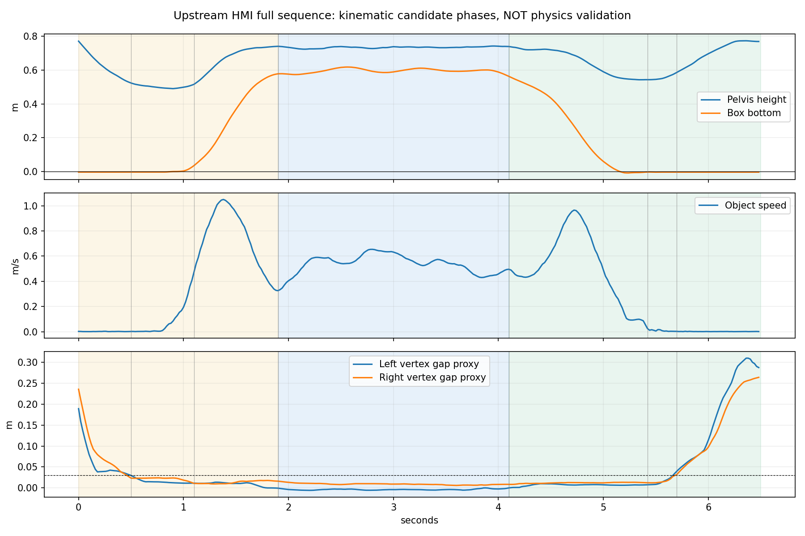

# Unified HOI Stage 1 (experimental, not ready for long training)

Base: `6c3eed6`; branch: `feature/unified-hoi-stage1`. This is a separate experiment; `stage1_joint_squat_walk` and its evidence remain intact.

One HMI PPO Actor/Critic trains all six clips, Track-only, no Gen/AMP/world model. The free original LargeBox remains 1.1kg with gravity/collisions, original half-sphere-hand G1, torque limits, fixed materials, 1ms physics and 20ms policy. There is no attachment or object pose writing during an episode.

**Current status (2026-11-21 HMI launch revision):** original `train_agent.py` completed8192 environments ×2 updates, peak8702MiB, finite PPO/checkpoint/ONNX and family/phase logs verified. The user-authorized15000-update Track-only run uses the same direct entry. `full_training_ready=False` remains historical physical-validation information and no longer prohibits training. Physical source/policy failures are retained; they are not a learning early-stop rule. See [launch/config report](UNIFIED_HOI_HMI_STAGE1_RUN.md) and the [historical implementation audit](UNIFIED_HOI_STAGE1_IMPLEMENTATION_REPORT.md).

## Data and phases

[Manifest](datasets/unified_hoi_v1/manifest.json), [timeline](datasets/unified_hoi_v1/audit/MOTION_TIMELINE.md), [phase labels](datasets/unified_hoi_v1/audit/phase_annotations.json), [physics audit](datasets/unified_hoi_v1/audit/physics_audit.json).



The complete original upstream files are byte-identical to local originals at upstream commit `c353731999b3578c41ad5a00f896415b45e6a9f5`. No redownload/replacement of working assets was needed; pinned original bytes were independently exported into local audit artifacts. The full sequence has 325 frames/6.48s and includes kinematic pickup, carry, lowering and release candidates. It begins within reach of a floor-supported box; it does not demonstrate a long walking approach.

Canonical full/mirrored sequences and loaded crops preserve root/joint/object poses, regenerate collision-URDF body FK and all velocities, and remain **not physics-validated**. Both P0 12cm squat files are exact copies and retain P0 controller validation. No hand retargeting is silently applied. A walk→squat→walk transition is missing, not spliced by teleportation.

Environment-step family allocation defaults to 30/35/35. Full-sequence random resets additionally balance pickup/carry/putdown starts; 25% of resets start a clip at frame0. Adaptive within-clip sampling remains for the loaded families. Every observed and completed episode step is logged, so shorter phases/early failures remain visible.

## Local environment and validation

```bash
cd /home/han/pyx/g1_carry_baseline_new/HMI
unset PYTHONPATH PYTHONHOME VIRTUAL_ENV LD_LIBRARY_PATH
export PYTHONNOUSERSITE=1 OMNI_KIT_ACCEPT_EULA=1 OPENBLAS_NUM_THREADS=1 OMP_NUM_THREADS=1
../envs/g1_hmi_carry/bin/python scripts/carry/prepare_unified_hoi.py --verify-only
../envs/g1_hmi_carry/bin/python -m pytest tests/test_unified_hoi.py tests/test_stage1_repair.py \
  tests/test_stage1_joint.py tests/test_stage1_pretrain_audit.py tests/test_carry_interface.py \
  tests/test_carry_supervisor.py tests/test_fullbody_carry.py \
  src/holosoma/holosoma/managers/command/tests src/holosoma/holosoma/managers/termination/tests \
  src/holosoma/holosoma/envs/wbt/tests/test_wbt_manager.py --import-mode=importlib -q
```

To create another version without replacing this dataset:

```bash
../envs/g1_hmi_carry/bin/python scripts/carry/prepare_unified_hoi.py \
  --output ../artifacts/unified_hoi_candidate_v2 --family-weights 0.30 0.35 0.35
```

Preparation refuses existing output directories. Reset eligibility means mechanically/kinematically eligible; physical stability of every arbitrary source frame is not certified.

## Training and manual resume

Primary direct HMI entry (all8192 environments, same six clips, no worker instrumentation):

```bash
WANDB_MODE=offline bash scripts/carry/train_unified_hmi_stage1.sh \
  "../artifacts/unified_hoi_hmi_stage1/manual_$(date +%Y%m%d_%H%M%S)" 15000
```

For training followed by sequential10-seed independent evaluation, use `train_unified_hmi_then_evaluate.sh NEW_OUTPUT_DIRECTORY`. It runs the same single HMI process; no plateau, budget segmentation, reward edits, retries or Stage2. Existing diagnostic/recovery entry remains available:

```bash
# Fresh one-process shared PPO smoke run; unique output, no old checkpoint loaded
bash scripts/carry/train_unified_hoi.sh --num-envs 256 --iterations 4 --save-every 2

# Inspect the eventual full-run configuration without launching it
bash scripts/carry/train_unified_hoi.sh --num-envs 8192 --iterations 15000 --dry-run
```

The diagnostic entry supports256/1024/4096/8192; both256 and8192 were exercised. The new direct-entry script fixes8192, as requested. `--data /path/to/new_bundle` selects a separately versioned dataset. The diagnostic entry supports `--iterations 15000 --save-every 500` as one uninterrupted `learn()` call; the previous32-update/physical-readiness prohibition was removed. Source validation flags are unchanged. No automatic Stage2, restart, time budget or plateau loop is invoked. The direct HMI run keeps the base PPO hyperparameters:128 minibatches,5 epochs, std0.3,24 rollout steps; differences from upstream are explicitly audited, not silently tuned.

The diagnostic entry saves PID, exact argv, commit/dirty status, source archive/patch plus hashed worktree text snapshot, manifest, `holosoma_config.yaml`, durable per-update JSON, TensorBoard, checksummed full checkpoints and ONNX metadata. Its outputs: `../artifacts/unified_hoi_stage1/run_*/`.

This exact recovery pattern was tested: checkpoint00003 (4 completed updates) → total target5 performs **one** update, restoring model/optimizers/normalizers/sampler/configuration state:

```bash
MODEL=../artifacts/unified_hoi_stage1/smoke_002_data/tensorboard/WholeBodyTracking/20261121_095047-unified_hoi_stage1-locomotion/model_00003.pt
bash scripts/carry/train_unified_hoi.sh --num-envs 256 --iterations 5 \
  --resume "$MODEL" --run-dir "../artifacts/unified_hoi_stage1/recovery_$(date +%Y%m%d_%H%M%S)"
```

Physical episodes restart on resume; this is not a bit-exact simulator-state continuation. Old 348D checkpoints and different dataset manifests are rejected.

## TensorBoard

```bash
../envs/g1_hmi_carry/bin/python -m tensorboard.main \
  --logdir ../artifacts/unified_hoi_stage1 --host 127.0.0.1 --port 6014
```

For the new HMI run use `--logdir ../artifacts/unified_hoi_hmi_stage1 --port 6015`. W&B is recorded offline because online authentication returned HTTP403; sync after restoring access. Open http://127.0.0.1:6014 for historical runs, or http://127.0.0.1:6015 for this training. Inspect `Env/hoi/family_fraction/*`, `mode_fraction/*`, `observed_steps/*`, `completed_episode_steps/*`, family/phase physical metrics and termination breakdowns. `Env/stage1/family/*/completed/*` contains completed-episode aggregates. Pickup/putdown force fractions differ legitimately from Carry, so do not average them together to claim grasp success.

## Independent probes, evaluation and viewer

```bash
# Diagnostic PD reference-position probe, NOT a policy or physics certification
../envs/g1_hmi_carry/bin/python scripts/carry/evaluate_unified_hoi.py --probe --seeds 3 \
  --output "../artifacts/unified_hoi_stage1/probes_$(date +%Y%m%d_%H%M%S)"

# Deliberately untrained 4-update model: demonstrates the evaluation chain and records failures
POLICY=../artifacts/unified_hoi_stage1/smoke_003_data/tensorboard/WholeBodyTracking/20261121_100537-unified_hoi_stage1-locomotion/model_00003.onnx
../envs/g1_hmi_carry/bin/python scripts/carry/evaluate_unified_hoi.py --policy "$POLICY" --seeds 3 \
  --output "../artifacts/unified_hoi_stage1/eval_$(date +%Y%m%d_%H%M%S)"

# Viewer/video entry; requires a working display/rendering session
../envs/g1_hmi_carry/bin/python scripts/carry/evaluate_unified_hoi.py --policy "$POLICY" --seeds 3 \
  --only E_full_pick_carry_putdown --view --video \
  --output "../artifacts/unified_hoi_stage1/view_$(date +%Y%m%d_%H%M%S)"
```

Headless evaluation was tested. By default each case runs in a fresh Isaac process, sequentially; cases do not share contact history or GPU processes. GUI/video switches use the existing Isaac viewer/recorder; GUI playback was not visually verified in this task. Actual data are always saved as rollout NPZ plus `evaluation.json`, including failures before automatic Reset. Policy trials use seeds1000+i for small **initial** joint-velocity perturbations (std0.001rad/s); reference probes use exact deterministic Reset replicas.

Suites A–E cover pickup, available loaded walking (2.18s), single/repeated squat and full sequence. Extra cases inspect pickup→carry, carry→putdown, support and release. F walk→squat→walk is explicitly unavailable. No active episode jumps clips. The available walking clip is not a20-second robustness qualification.

Carry acceptance reuses existing lateral-grasp/friction/slip/clearance/nonhand gates. Pickup must acquire physical support and lift. Putdown requires measured ground support, low object speeds, 0.2s support dwell and 0.5s stable released state with no nonhand box contact (>0.5N). Full completion requires all modes in the same first episode. Final certification needs at least10 seeds per required case with80% per-case success; short probe/NN tests never certify a policy.

## Explicit task mode and future Stage2 interface

Actor frame = existing116 physical/4D-goal features + three-way mode one-hot; history3 → **357D**. Critic =119 physical/mode +68 privileged reference → **187D**. Four continuous goals stay `[vx,vy,yaw_rate,pelvis_height]`; task mode is separate. Walking and squatting both use `carry`.

`UnifiedActor.act(..., commands=goal4, task_mode='pickup'/'carry'/'putdown')` requires explicit intention. It does not load a motion or infer mode from a reference clock. `joint_position_target(action,q_measured)` uses the retained `joint_delta_v1`; sample once per20ms and hold target for20 PD substeps. Changing mode does not reset history, robot or box. This API passed a separate no-MotionLoader inference test.

Metadata uses carry schema2/unified schema1, records dimensions/modes/decoder/manifest fingerprint and ONNX parity. The legacy `CarryActor` refuses this model. Future Stage2 must retain this explicit mode and357D interface; using the old348D Stage2 unmodified is incompatible. No Stage2/Gen training is implemented or started here.
