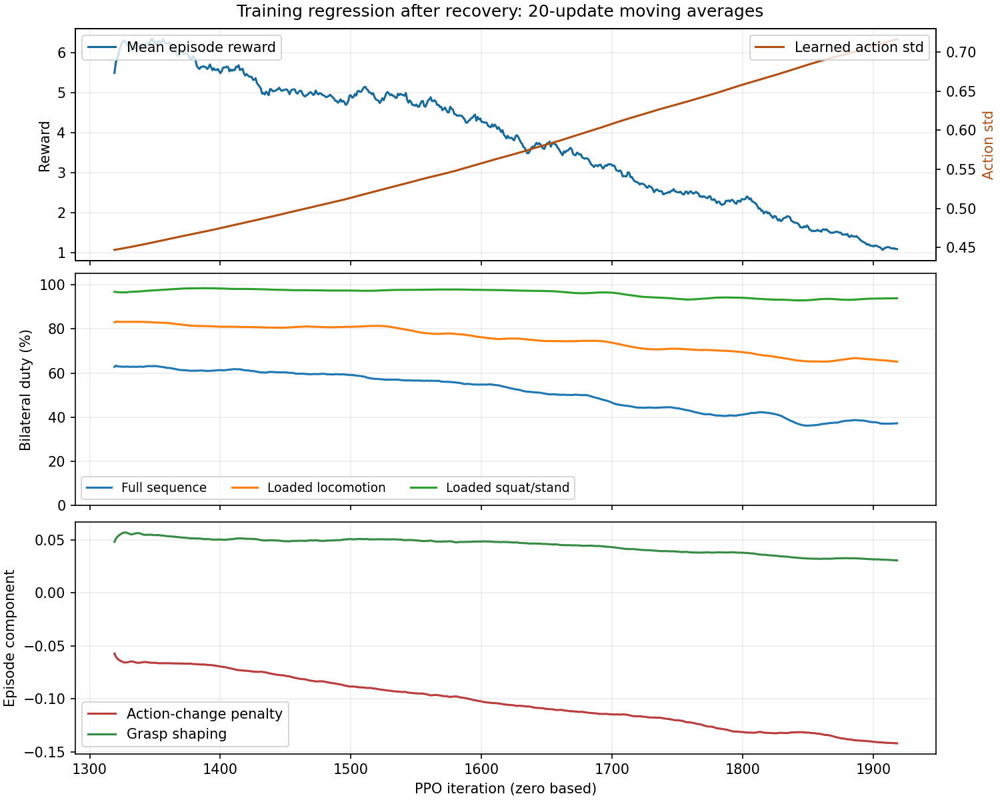

# Stage1 学习退化诊断与运行记录（2026-11-23）

运行快照：2026-11-23 21:18:49，北京时间。进度为当时观测值；后续以实际training_status.json为准。

## 结论与修改范围

固定起点的配对诊断确认：可学习std增大会加剧接触/回报下降；新checkpoint在关闭噪声后的完整取放和持箱行走表现也有回退，蹲起基本保持。

**导致均值策略回退的具体代码或任务配置根因尚未隔离证明，学习退化尚未修复。** std增长不是完整解释，继续训练到15000也不保证自然恢复。这里的不稳定指动作与接触，和先前Rich渲染卡死分开记录。

已有生产修复均已推送：`0af6902`修复支撑/释放、采样、critic状态及checkpoint生命周期；`35b483d`修复Bool日志与Isaac中断识别；`5756def`移除Rich Live、保存先于日志、分离严格训练/推理加载并修复原生play/Viser入口。

本次增加报告、精简证据和已执行诊断源码快照，正式训练参数保持原样。Actor仍为357D“四维command＋额外任务意图”，critic为207D，未声称纯四维完整取放控制器已完成。

## 初始std与可学习std

实际采样为 `a = mu(o) + std * epsilon`，epsilon为标准高斯噪声。std在源码中是可训练的nn.Parameter；配置`init_noise_std=0.3`仅负责初始化，不是上限或固定值。

| 观测位置 | 实际std均值 |
|---|---:|
| 从头初始化 |0.3000|
| 完成1300更新的checkpoint |0.4435|
| 完成1900更新的checkpoint |0.7113|
| 本次冻结的2014更新模型 |0.7741|
| 最新日志：完成2078更新 |0.8074|

正式设置仍为初始std0.3、可学习、entropy_coef0.002、reset_policy_std_on_resume=False。没有给正式训练新增std增长调度、固定std或降低后的std。诊断的临时std替换未用于正式续训。默认原生play使用均值动作，直接改变std不能立刻修复已学均值网络的回退。

## 训练窗口中的下降

同一恢复进程，分别取100次更新均值：

| 指标 |1300–1399|1800–1899|
|---|---:|---:|
| Mean episode reward |5.87|1.59|
| 可学习std |0.460|0.688|
| 完整序列双手接触占空比 |62.1%|38.5%|
| 动作变化惩罚分项 |−0.065|−0.135|
| Critic value loss |223|740|

Episode分项总下降中，动作变化惩罚加重约占49.6%；该分项口径与Train/mean_reward不同，不能直接混加。没有证明Value loss上升本身就是均值回退的原因。

Family份额仍为30%/35%/35%。从1300和1900 checkpoint重建实际sampler的eligible-frame条件分布并保留25% frame0后，各motion的reset分布总变差距离约0.011–0.053。采样确有变化，但不能直接解释全部下降；累计参考末帧率会平滑近期变化。

## 配对物理诊断与梯度

诊断调用实际PPO._rollout_step和_compute_ppo_loss。8192环境，seed314159，每组3个rollout，共72个20ms控制步（1.44秒）；原控制、资产、奖励、终止保持一致。各组初始reference和关节姿态hash一致，只统计首episode仍有效的控制步，结束后不混入后续episode。独立Isaac进程串行运行，optimizer更新数为0。

旧模型完成1300更新，新冻结模型完成2014更新。关闭噪声指使用均值动作，没有把std参数设零。以下为接触占空比，**不是frame0完整取放物理成功率**：

| Reference |旧模型均值动作|新模型均值动作|新模型当前噪声|
|---|---:|---:|---:|
| 完整取放 | 72.3% | 59.0% | 45.7% |
| 持箱行走 | 91.5% | 82.4% | 66.9% |
| 持箱蹲起 | 99.2% | 99.4% | 95.0% |

保持新均值网络及初始normalizer不变，只将std换成旧向量（均值0.4435）后，持箱行走接触占空比由66.9%提高到78.7%，此有限诊断中首episode物理失败比例由13.0%降至7.4%；完整序列接触占空比由45.7%提高到55.8%。这证明了噪声的因果贡献，没有证明长期最优std。

临时换回旧std的同一新模型，3个rollout、12个minibatch的平均std梯度：任务surrogate为`+0.001189`，entropy为`-0.004711`，合计`-0.003522`。梯度下降下正值偏向收缩、负值偏向扩大；按逐关节平均梯度，entropy将9/29个关节的收缩方向翻为扩大。这不是所有历史update都由entropy主导的证明，也未验证新的最优系数。

前两次同进程多组诊断分别在重复reset、重复checkpoint加载处遇到InferenceMode张量原地更新限制，整体测试未通过。日志原位保留。最终对照采用已完成的2014 current_native组与随后三个独立进程组，核对共同起点hash；未把上述热加载/重置限制认作连续训练回报下降的根因。

## 保全与当前正式运行

诊断前分别在2010、2014、2021完整update后安全保存，未丢失已完成更新；wrapper记录interrupted并跳过训练后evaluation。诊断状态未用作续训初始化。

最终从2021正式保全状态恢复，目标总计15000，配置剩余12979次更新；8192环境、24步rollout、4 minibatches、5 epochs、Track-only、归档2000/latest100保持原样。Actor/Critic、optimizer、normalizer、已学std和sampler从正式状态恢复。

| 运行项 |2026-11-23 21:18:49观测值|
|---|---|
| 完成更新 |2078/15000|
| Actor/Critic累计optimizer steps |41560/41560|
| service |`hmi-stage1-after-probe-20261123-2050.service`|
| controller / learner PID |758663 / 760010|
| run |`/home/han/pyx/g1_carry_baseline_new/artifacts/unified_hoi_hmi_stage1/formal_recovery_after_probe_20261123_2050`|
| TensorBoard |http://127.0.0.1:6016|
| TensorBoard service |`hmi-stage1-history-20261123-tensorboard.service`|

完整resolved config路径见[运行快照](experiments/unified_hoi/learning_regression_20261123/runtime_snapshot.json)，console为run目录下的training.console.log。TensorBoard将1300–2010、2010–2014、2014–2021和当前进程分别标记，保留原事件与曲线。训练和TensorBoard在关闭对话框后继续运行。

正式恢复checkpoint：`/home/han/pyx/g1_carry_baseline_new/artifacts/unified_hoi_hmi_stage1/causal_probe_20261123_2050/retained_for_resume.pt`，内部completed_updates=2021，SHA256为`c40d2892f04d51f93de4578fa75dbf79d77c7a1a0f58cd1676cf18857ae80f8b`。

活进程及其源码归档仍指向`5756defebd5fcd08e7ec683e20221abd7e02c958`；本报告提交不热更改活进程。自然完成后的既有10-seed独立评估保留，不自动进入Stage2，未增加reward平台期自动停训规则。

## 证据与复核

- [配对结果、逐关节平均梯度及未解决项](experiments/unified_hoi/learning_regression_20261123/causal_summary.json)
- [训练窗口统计和近似episode窗口](experiments/unified_hoi/learning_regression_20261123/training_windows.json)
- [实际sampler分布重建](experiments/unified_hoi/learning_regression_20261123/sampler_checkpoint_comparison.json)
- [已执行的独立进程诊断源码快照](experiments/unified_hoi/learning_regression_20261123/probe_snapshot.py)与[协议及环境变量](experiments/unified_hoi/learning_regression_20261123/probe_protocol.json)
- [精简文件校验和](experiments/unified_hoi/learning_regression_20261123/evidence_manifest.json)

probe_snapshot.py是测量归档，不替代正式训练入口。它仅在新诊断进程内替换learn以收集数据，依赖既有HMI环境和本机已验证checkpoint；必须串行使用Isaac/GPU锁。HMI_CAUSAL_CURRENT固定为2014模型，与正式续训的2021 checkpoint分开。

大checkpoint、完整TensorBoard/W&B/console和失败诊断日志仍在`../artifacts/unified_hoi_hmi_stage1/`，未加入Git。运行故障与上游差异见[Rich停滞修复报告](RICH_LIVE_STALL_REPAIR_20261123.md)。
